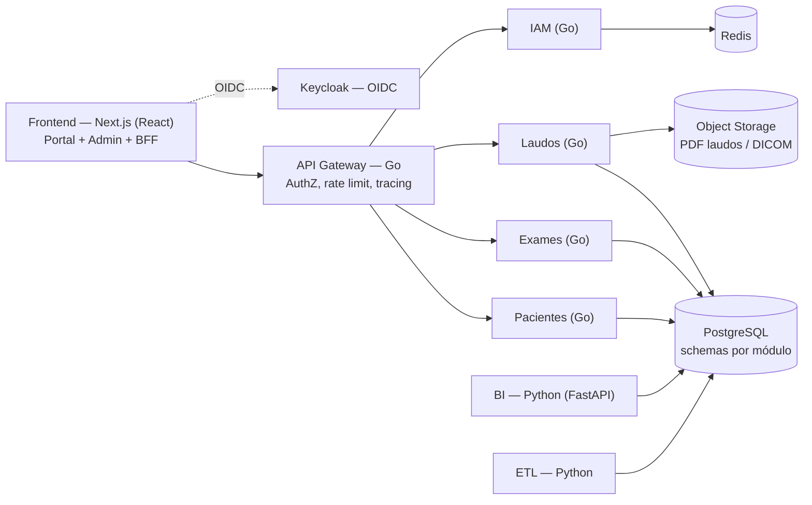

# 🧠 Cérebro do Projeto — SIGLO
**Sistema Integrado de Gestão de Laboratório Oncológico**

> Este arquivo é o **hub central** (Map of Content) do projeto. Todo conhecimento parte daqui.
> Convention: `[[Wikilink]]` = página do projeto (a criar em `docs/` conforme o [[Índice de Páginas]]). O conteúdo essencial está inline neste documento; os wikilinks definem a malha de conhecimento que o time vai expandir.

---

## 🧭 Navegação Rápida

| Tema | Seção |
|---|---|
| Visão, problema e personas | [[#1-visão-do-produto]] · [[Visão do Produto]] · [[Personas e Stakeholders]] |
| Módulos de domínio | [[#2-módulos-de-domínio]] · [[Módulo Pacientes]] · [[Módulo Exames]] · [[Módulo Laudos]] · [[Módulo BI]] |
| Arquitetura (Frontend · Backend · Dados) | [[#3-arquitetura-de-software]] · [[Arquitetura Frontend]] · [[Arquitetura Backend]] · [[Modelo de Dados]] |
| Boas práticas de engenharia | [[#4-boas-práticas-de-engenharia]] · [[Padrões de Código]] · [[CI/CD]] |
| Plano de sprints | [[#5-roadmap-de-sprints]] · [[Roadmap de Sprints]] |
| Qualidade, LGPD e usabilidade | [[#6-qualidade-de-software]] · [[#7-segurança-e-lgpd]] · [[#8-usabilidade-e-acessibilidade]] |
| Governança | [[#9-métricas-riscos-e-rituais]] · [[Registro de Riscos]] · [[Rituais do Time]] |
| Mapa de páginas | [[#10-índice-de-páginas]] · [[Índice de Páginas]] |

---

## 1. Visão do Produto

### 1.1 Problema
Laboratórios oncológicos operam com processos fragmentados (planilhas, sistemas legados, WhatsApp) entre coleta, análise e emissão de laudos. Consequências: atrasos no diagnóstico, retrabalho, falta de rastreabilidade da amostra e ausência de indicadores de gestão.

### 1.2 Solução
Plataforma web modular que digitaliza o fluxo ponta a ponta do laboratório: **cadastro de pacientes → ordem e coleta de exames → rastreabilidade da amostra → análise → laudo revisado e assinado → liberação ao paciente/médico → BI para gestão**.

### 1.3 Objetivos de Produto
1. Reduzir o **turnaround time (TAT)** entre coleta e liberação do laudo.
2. Garantir **rastreabilidade** integral da amostra (coleta → resultado).
3. Assegurar **conformidade LGPD** por padrão (privacy by design).
4. Oferecer experiência humana e acessível a pacientes/cuidadores, conforme o [[Design System — Serene Clinical Humanism]] (`stitch_app_oncologia_pedi_trica/serene_clinical_humanism/DESIGN.md`).
5. Entregar **BI gerencial** com dados pseudonimizados.

### 1.4 Personas
| Persona | Necessidade principal | Módulo principal |
|---|---|---|
| Patologista | Emitir/revisar laudos com templates e dupla checagem | [[Módulo Laudos]] |
| Técnico/Biomédico | Registrar coleta e rastrear amostras sem erro | [[Módulo Exames]] |
| Recepção/Gestor | Agendar, cadastrar e acompanhar fila de trabalho | [[Módulo Pacientes]] · [[Módulo Exames]] |
| Paciente / Cuidador familiar | Acompanhar exames e laudos com clareza e calma | Portal do Paciente (S7) |
| Administrador / DPO | Governar acessos, auditoria e privacidade | [[Módulo Identidade e Acesso]] · [[Módulo Auditoria e Conformidade]] |
| Diretoria | Indicadores e tomada de decisão | [[Módulo BI]] |

Detalhes: [[Personas e Stakeholders]] · Requisitos vivos: [[Backlog do Produto]] · Vocabulário clínico: [[Glossário Clínico]]

---

## 2. Módulos de Domínio

O código é organizado por **módulo de domínio** (bounded contexts). Cada módulo tem seu schema no banco, seus testes e sua documentação — facilitando manutenção e evolução independente.

| Módulo | Responsabilidade | Entidades principais | Fronteira |
|---|---|---|---|
| [[Módulo Pacientes]] | Cadastro, consentimentos, vínculo cuidador–paciente, histórico | `paciente`, `consentimento`, `vinculo_cuidador` | Não conhece exames |
| [[Módulo Exames]] | Catálogo de exames, ordem de serviço, coleta, rastreabilidade de amostra, resultados brutos | `ordem_exame`, `amostra`, `resultado` | Consome apenas `paciente_id` |
| [[Módulo Laudos]] | Emissão, revisão (dupla checagem), versionamento, assinatura digital, liberação | `laudo`, `versao_laudo`, `assinatura` | Referencia `ordem_exame_id` |
| [[Módulo BI]] | Dashboards, indicadores (TAT, produtividade, retrabalho), ETL de dados pseudonimizados | `fato_tat`, `dim_tempo`, `dim_exame` | Somente leitura; sem PII |
| [[Módulo Identidade e Acesso]] | Autenticação OIDC, RBAC, sessões | `papel`, `permissao`, `usuario` | Cross-cutting |
| [[Módulo Notificações]] | E-mail/SMS de status (coleta realizada, laudo liberado) | `notificacao`, `template` | Cross-cutting |
| [[Módulo Integrações Clínicas]] | HL7/FHIR, LIS legado, DICOM (spike) | `contrato_integracao` | Anticorrupção |
| [[Módulo Auditoria e Conformidade]] | Trilha de auditoria imutável, inventário LGPD, retenção | `evento_auditoria`, `base_legal` | Cross-cutting |

**Regra de ouro:** comunicação entre módulos acontece por **contratos explícitos** (OpenAPI em `packages/contracts`) e eventos de domínio — nunca por acesso direto ao schema do vizinho.

---

## 3. Arquitetura de Software

### 3.1 Princípios
1. **Modular primeiro**: modular monolith com fronteiras rígidas; extração para microserviços só quando houver dor real (evolução documentada em [[Decisões de Arquitetura (ADRs)]]).
2. **Separação Frontend / Backend / Dados** com contratos versionados.
3. **Privacy by design** e **security by default** (LGPD + OWASP ASVS).
4. 12-Factor, observabilidade nativa, infraestrutura como código.

### 3.2 Diagrama



### 3.3 Escolha de stack (decisão)
| Camada | Escolha | Justificativa |
|---|---|---|
| **Frontend** | **Next.js (React) + TypeScript** | SSR/RSC para portal do paciente, BFF embutido, ecossistema shadcn/ui + Tailwind; tokens do [[Design System — Serene Clinical Humanism]] |
| **Backend — núcleo de domínio** | **Go** (chi/Fiber + `pgx`) | Alta concorrência para filas de exame/laudo, tipagem forte, binários leves, baixo custo operacional |
| **Backend — dados & BI** | **Python** (FastAPI + pandas/dbt) | Produtividade em ETL, análise estatística, geração de PDF de laudos e futura camada de ML |
| **Banco de dados** | **PostgreSQL 16** (+ Redis, Object Storage S3-compatível) | ACID para fluxo clínico, schemas por módulo, JSONB para resultados heterogêneos, madurez para BI |
| Autenticação | Keycloak (OIDC/OAuth2) | RBAC fino, MFA para equipe clínica, auditável |
| BI de visualização | Metabase ou Superset sobre views pseudonimizadas | Rapidez para MVP do [[Módulo BI]] |

Decisões registradas: [[Decisões de Arquitetura (ADRs)]] (ADR-0001 monorepo, ADR-0002 Go+Python, ADR-0003 Postgres por schemas, ADR-0004 Keycloak).

### 3.4 Monorepo (estrutura-alvo)

```text
siglo/
├── CEREBRO-DO-PROJETO.md        # 🧠 este hub
├── docs/                        # wiki expandida (ver Índice de Páginas)
├── apps/
│   └── web/                     # Next.js — portal paciente + admin
├── services/
│   ├── core/                    # Go — modular monolith de domínio
│   │   ├── internal/
│   │   │   ├── pacientes/       # handler → service → repository
│   │   │   ├── exames/
│   │   │   ├── laudos/
│   │   │   ├── iam/
│   │   │   └── auditoria/
│   │   └── cmd/api/
│   └── bi/                      # Python — FastAPI + pipelines ETL
├── packages/
│   ├── contracts/               # OpenAPI + schemas compartilhados
│   └── ui/                      # design system (tokens Serene Clinical Humanism)
├── infra/                       # docker-compose, IaC, migrações
└── .github/workflows/           # CI/CD
```

Padrão interno de cada módulo backend: **handler → service → repository**, validação na borda, erros de domínio tipados. Detalhes: [[Arquitetura Backend]] · Frontend: [[Arquitetura Frontend]] · Dados: [[Modelo de Dados]] · Ambientes: [[Ambientes e Infraestrutura]]

---

## 4. Boas Práticas de Engenharia

| Prática | Padrão |
|---|---|
| Versionamento | Trunk-based com branches curtas (`feat/…`, `fix/…`); Conventional Commits; release semântico |
| Code review | 1 aprovação obrigatória (2 em módulos clínicos: laudos/exames); checklist em [[Code Review]] |
| Contratos | API-first: OpenAPI em `packages/contracts` antes da implementação |
| Estilo | Go: `gofmt` + `golangci-lint` · Python: `ruff` + `mypy` · TS: ESLint + Prettier |
| Migrações | Versionadas e imutáveis (golang-migrate / Alembic) — nunca DDL manual |
| Erros e logs | Erros de domínio tipados; logs estruturados JSON **sem PII** |
| Feature flags | Toda funcionalidade de risco entra atrás de flag |
| Documentação | ADRs para toda decisão arquitetural; README por módulo |
| Segurança de pipeline | SAST (Semgrep), análise de dependências (govulncheck, pip-audit, npm audit) |

Referências: [[Padrões de Código]] · [[Política de Branches e Commits]] · [[CI/CD]] · [[Definição de Pronto (DoD)]]

---

## 5. Roadmap de Sprints

Cadência: **sprints de 2 semanas** · Sprint 0 com 1 semana · MVP clínico ao fim do Sprint 6 · go-live no Sprint 10.
Gestão completa: [[Roadmap de Sprints]] · Rituais: [[Rituais do Time]] · DoD por sprint: [[Definição de Pronto (DoD)]]

> Cada sprint incorpora etapas de **QA**, **segurança/LGPD** e **usabilidade** — qualidade é contínua, não fase final.

| Sprint | Foco | Entregas principais | QA · LGPD · UX embutidos |
|---|---|---|---|
| [[Sprint 00 — Fundações]] (sem. 0) | Setup | Monorepo, CI/CD, ambientes, ADRs 0001–0004, backlog inicial, tokens do design system no `packages/ui` | Pipeline com lint+testes+SAST ativos desde o dia 1; rascunho do [[Inventário de Dados (LGPD)]] |
| [[Sprint 01 — Identidade e Acesso]] | IAM | Keycloak OIDC, RBAC, shell Next.js autenticado, trilha de auditoria v1 | Testes E2E de login; matriz RBAC revisada por segurança |
| [[Sprint 02 — Pacientes]] | [[Módulo Pacientes]] | CRUD, busca, consentimentos, vínculo cuidador | Testes unit+integração ≥80% no diff; PII mascarada em logs; validação de consentimento LGPD |
| [[Sprint 03 — Exames: fluxo]] | [[Módulo Exames]] | Catálogo, ordem de serviço, status (coleta→triagem→análise) | Testes de workflow; teste de usabilidade moderado com técnico (protótipo) |
| [[Sprint 04 — Rastreabilidade]] | [[Módulo Exames]] | Código de barras/QR da amostra, upload de resultados (S3), spike HL7/FHIR | Testes de integração com storage; auditoria de acesso a anexos |
| [[Sprint 05 — Laudos: emissão]] | [[Módulo Laudos]] | Templates, editor estruturado, fluxo de dupla revisão | Testes do fluxo de revisão; par de revisão clínica obrigatório |
| [[Sprint 06 — Laudos: liberação]] | [[Módulo Laudos]] | Versionamento, assinatura digital, liberação + [[Módulo Notificações]] | Trilha de acesso ao laudo; retenção configurada; **MVP clínico completo** |
| [[Sprint 07 — Portal do Paciente]] | UX | Portal responsivo com o [[Design System — Serene Clinical Humanism]] | WCAG 2.1 AA; teste com 5 usuários (paciente/cuidador); baseline SUS |
| [[Sprint 08 — BI]] | [[Módulo BI]] | Modelo estrela, ETL Python, dashboards TAT/retrabalho em Metabase/Superset | Dados **pseudonimizáveis**; validação de indicadores com a diretoria |
| [[Sprint 09 — Hardening LGPD]] | Segurança | Pentest interno, RIPD, plano de resposta a incidentes, backup/DR drill | SAST/DAST limpos; revisão final do DPO; [[Plano de Resposta a Incidentes]] testado |
| [[Sprint 10 — UAT e Go-live]] | Entrega | Correções de UAT, testes de usabilidade finais, playbook de operação, go-live | Testes E2E de regressão; checklist de lançamento; plano de rollback |

---

## 6. Qualidade de Software

**Pirâmide de testes** (alvo de distribuição 70/20/10) — plano completo em [[Plano de Testes]]:

| Nível | Ferramenta | Regra |
|---|---|---|
| Unitários | `testing`+testify (Go), pytest (Python), Vitest (TS) | Cobertura ≥ 80% no diff; testes de regra de negócio isolados |
| Integração | testcontainers (PG/Redis/S3) | Todo repository e fluxo inter-módulo testado |
| E2E | Playwright | Jornadas críticas: login, nova ordem, emissão e liberação de laudo |
| Carga | k6 | Pico simulado de 10× uso médio sem degradação de TAT de API |
| Contrato | OpenAPI diff no CI | Breaking change bloqueia merge |

**Gates de qualidade (CI)** — detalhes em [[Gates de Qualidade]]: build verde → lint → testes → cobertura → SAST/deps → contrato → imagem assinada.
**Critérios de aceite** por história: [[Critérios de Aceite]] · Bugs pós-release rastreados em [[KPIs e Métricas]] (bug escape rate < 5%).

---

## 7. Segurança e LGPD

Base legal predominante: **tutela da saúde (art. 11, LGPD)** — dados sensíveis de saúde; consentimento explícito apenas para finalidades acessórias (ex.: comunicação marketing). Governança completa: [[Módulo Auditoria e Conformidade]].

| Controle | Implementação |
|---|---|
| Inventário e classificação de dados | [[Inventário de Dados (LGPD)]] — todo dado sensível mapeado com base legal e finalidade |
| Minimização e finalidade | Coleta restrita ao necessário; campos justificados no inventário |
| Pseudonimização/anonimização | Views pseudonimizadas para BI; anonimização em exports analíticos |
| Criptografia | TLS 1.3 em trânsito; AES-256 em repouso (banco e object storage) |
| Controle de acesso | RBAC de menor privilégio em [[Matriz de Papéis e Permissões (RBAC)]]; MFA para equipe clínica |
| Auditoria | Trilha append-only de todo acesso a dado de saúde (quem, quando, o quê) |
| Retenção e descarte | [[Política de Retenção de Dados]] conforme prazos aplicáveis (validar com DPO/CFM) |
| Direitos do titular | Fluxos de acesso, correção e eliminação (quando aplicável) no [[Módulo Pacientes]] |
| Impacto e incidentes | [[RIPD — Relatório de Impacto]] · [[Plano de Resposta a Incidentes]] (notificação ANPD/titulares) |
| Segurança de desenvolvimento | OWASP ASVS L2, SAST/DAST, secrets em cofre — nunca em código |

**Responsabilidades:** Controlador = o laboratório; Operadores = fornecedores de nuvem/e-mail — contratos de operador obrigatórios. Papel do DPO descrito em [[Módulo Auditoria e Conformidade]].

---

## 8. Usabilidade e Acessibilidade

Fundamentada no [[Design System — Serene Clinical Humanism]] (já presente no repositório): SOBERANO E ACOLHEDOR, para usuários sob fadiga, "chemo brain" e sobrecarga sensorial.

| Prática | Regra |
|---|---|
| Design tokens | Paleta teal/linho, Plus Jakarta Sans, base 15px, alvos de toque ≥ 48px — extraídos para `packages/ui` no Sprint 0 |
| Acessibilidade | WCAG 2.1 AA em toda tela; navegação por teclado e leitor de tela (detalhes: [[Acessibilidade WCAG 2.1 AA]]) |
| Carga cognitiva | Fluxos curtos, linguagem simples, help text sempre visível (nunca só tooltip) |
| Testes de usabilidade | 2 rodadas: protótipo (S3) e produto (S7) com pacientes/cuidadores e equipe clínica — plano em [[Plano de Testes de Usabilidade]] |
| Métricas | SUS ≥ 80 · conclusão de tarefa ≥ 90% · taxa de erro em formulários críticos < 5% ([[Métricas de UX (SUS)]]) |
| Heurísticas | Avaliação heurística de Nielsen em cada release de portal |

---

## 9. Métricas, Riscos e Rituais

**KPIs de produto:** TAT coleta→laudo · % laudos liberados em 1ª revisão · taxa de retrabalho de amostra.
**KPIs de engenharia (DORA):** frequência de deploy · lead time de mudança · taxa de falha de mudança · MTTR. Painel: [[KPIs e Métricas]].

**Principais riscos** (registro vivo em [[Registro de Riscos]]):

| Risco | Impacto | Mitigação |
|---|---|---|
| Vazamento de dado de saúde | Crítico | Criptografia, RBAC, auditoria, plano de incidentes, pentest (S9) |
| Integração com LIS legado falhar | Alto | Módulo anticorrupção, spike HL7/FHIR no S4, import manual como fallback |
| Validação clínica dos laudos | Alto | Dupla revisão obrigatória + padrão de templates com equipe médica (S5) |
| Baixa adoção pelos usuários | Médio | Design system humano, testes de usabilidade desde o S3, treinamento no go-live |

**Rituais:** daily 15min · planejamento · review/demo · retrospectiva · refinement semanal — detalhes em [[Rituais do Time]].

---

## 10. Índice de Páginas

Malha de wikilinks deste cérebro. Ao criar cada página em `docs/`, marque o status. Convention de arquivo: slug minúsculo sem acento.

| Categoria | Páginas (wikilinks) | Caminho-alvo | Status |
|---|---|---|---|
| Visão | [[Visão do Produto]] · [[Personas e Stakeholders]] · [[Backlog do Produto]] · [[Glossário Clínico]] | `docs/01-visao/` | 🟡 parcial — [[Backlog do Produto]] em `docs/01-visao/backlog-do-produto.md` |
| Módulos | [[Módulo Pacientes]] · [[Módulo Exames]] · [[Módulo Laudos]] · [[Módulo BI]] · [[Módulo Identidade e Acesso]] · [[Módulo Notificações]] · [[Módulo Integrações Clínicas]] · [[Módulo Auditoria e Conformidade]] | `docs/02-modulos/` | 🔴 a criar |
| Arquitetura | [[Decisões de Arquitetura (ADRs)]] · [[Arquitetura Frontend]] · [[Arquitetura Backend]] · [[Modelo de Dados]] · [[Ambientes e Infraestrutura]] · [[CI/CD]] | `docs/03-arquitetura/` | 🟡 parcial — ADRs 0001–0004 + [[Ambientes e Infraestrutura]] criados |
| Engenharia | [[Padrões de Código]] · [[Política de Branches e Commits]] · [[Code Review]] · [[Definição de Pronto (DoD)]] | `docs/04-engenharia/` | 🔴 a criar |
| Sprints | [[Roadmap de Sprints]] · [[Sprint 00 — Fundações]] · [[Sprint 01 — Identidade e Acesso]] · [[Sprint 02 — Pacientes]] · [[Sprint 03 — Exames: fluxo]] · [[Sprint 04 — Rastreabilidade]] · [[Sprint 05 — Laudos: emissão]] · [[Sprint 06 — Laudos: liberação]] · [[Sprint 07 — Portal do Paciente]] · [[Sprint 08 — BI]] · [[Sprint 09 — Hardening LGPD]] · [[Sprint 10 — UAT e Go-live]] | `docs/05-sprints/` | 🟡 parcial — [[Sprint 00 — Fundações]] em `docs/05-sprints/sprint-00-fundacoes.md` |
| Qualidade | [[Plano de Testes]] · [[Gates de Qualidade]] · [[Critérios de Aceite]] | `docs/06-qualidade/` | 🔴 a criar |
| LGPD | [[Inventário de Dados (LGPD)]] · [[Matriz de Papéis e Permissões (RBAC)]] · [[Política de Retenção de Dados]] · [[RIPD — Relatório de Impacto]] · [[Plano de Resposta a Incidentes]] | `docs/07-lgpd/` | 🟡 parcial — [[Inventário de Dados (LGPD)]] rascunho em `docs/07-lgpd/inventario-de-dados.md` |
| Usabilidade | [[Design System — Serene Clinical Humanism]] · [[Plano de Testes de Usabilidade]] · [[Acessibilidade WCAG 2.1 AA]] · [[Métricas de UX (SUS)]] | `docs/08-ux/` | 🔴 a criar |
| Governança | [[KPIs e Métricas]] · [[Registro de Riscos]] · [[Rituais do Time]] | `docs/09-governanca/` | 🔴 a criar |

**Regras do cérebro:** (1) todo novo conceito vira wikilink antes de virar página; (2) nomes de wikilink são canônicos — não renomear sem atualizar o índice; (3) este hub nunca cresce em detalhe: detalhe mora na página vinculada.

---

## Changelog

| Data | Versão | Mudança |
|---|---|---|
| 2026-09-17 | 0.2 | Sprint 00 executada: monorepo estruturado, CI (lint+testes+SAST), docker-compose local, ADRs 0001–0004, backlog inicial, tokens do design system em `packages/ui`, rascunho do [[Inventário de Dados (LGPD)]] |
| 2026-09-10 | 0.1 | Criação do cérebro: visão, arquitetura Go+Python/Next.js, módulos de domínio, roadmap de sprints 0–10, QA, LGPD e usabilidade |
