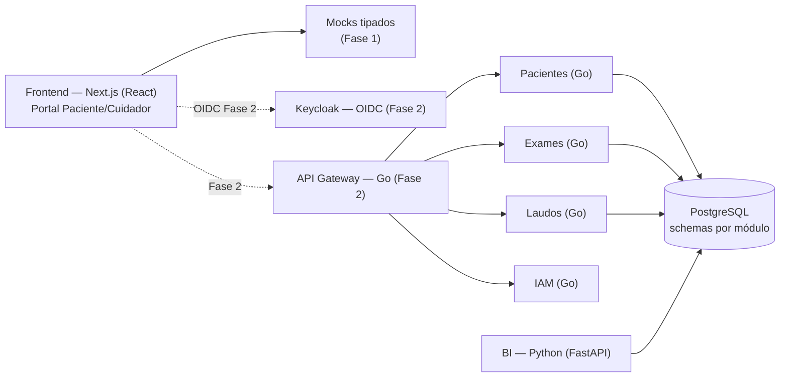

# 🧠 Cérebro do Projeto — SIGLO
**Sistema Integrado de Gestão de Laboratório Oncológico** · produto em foco: **Portal do Paciente/Cuidador "OncoVida"**

> Este arquivo é o **hub central** (Map of Content) do projeto. Todo conhecimento parte daqui.
> Convention: `[[Wikilink]]` = página do projeto (a criar em `docs/` conforme o [[Índice de Páginas]]). O conteúdo essencial está inline neste documento; os wikilinks definem a malha de conhecimento que o time vai expandir.

> [!IMPORTANT]
> **Diretriz vigente (v0.3 — 2026-10-14): Front-end First.**
> 1. O produto em foco é o **Portal do Paciente/Cuidador** — público **infantil** (paciente pediátrico) e **adulto** (cuidador familiar e paciente adulto).
> 2. A **Fase 1** entrega **100% do front-end** (UI/UX, componentes, rotas, estados de tela, interações) com **dados mockados**. **Nenhuma** lógica de servidor, banco ou integração real de API é implementada agora.
> 3. Todo trabalho de back-end (Go/Python/Postgres/Keycloak) foi movido para a **Fase 2** — ver [[#5-roadmap-de-sprints]] e [[ADR-0005 — Front-end First]].
> 4. **Rastreabilidade:** toda entrega começa com `📍 Sprint XX · Etapa XX.N — <nome>` (ver [[#5.3 Etapas padrão de cada sprint]]).

---

## 🧭 Navegação Rápida

| Tema | Seção |
|---|---|
| Visão, problema e personas | [[#1-visão-do-produto]] · [[Visão do Produto]] · [[Personas e Stakeholders]] |
| Módulos de domínio e do portal | [[#2-módulos-de-domínio]] · [[Módulos do Portal]] · [[Módulo Pacientes]] · [[Módulo Exames]] · [[Módulo Laudos]] |
| Arquitetura (Frontend · Backend · Dados) | [[#3-arquitetura-de-software]] · [[Arquitetura Frontend]] · [[Arquitetura Backend]] · [[Modelo de Dados]] |
| Boas práticas de engenharia | [[#4-boas-práticas-de-engenharia]] · [[Padrões de Código]] · [[CI/CD]] |
| Plano de sprints (Fase 1 front · Fase 2 back) | [[#5-roadmap-de-sprints]] · [[Roadmap de Sprints]] |
| Qualidade, LGPD e usabilidade | [[#6-qualidade-de-software]] · [[#7-segurança-e-lgpd]] · [[#8-usabilidade-e-acessibilidade]] |
| Governança | [[#9-métricas-riscos-e-rituais]] · [[Registro de Riscos]] · [[Rituais do Time]] |
| Mapa de páginas | [[#10-índice-de-páginas]] · [[Índice de Páginas]] |

---

## 1. Visão do Produto

### 1.0 Foco atual
O SIGLO é uma plataforma de laboratório oncológico; a **primeira face entregue** é o **Portal do Paciente/Cuidador (OncoVida)**, desenhado com **foco Mobile-First** (experiência fluida de Web App estilo aplicativo nativo/Instagram, otimizada para uso em smartphone com uma mão), que acompanha a rotina de tratamento da criança: check-in de humor e sintomas, remédios e rotina com dupla checagem, alimentação compassiva, exames e rede de apoio familiar. O portal é construído **front-end first** (Fase 1) e conectado ao back-end na Fase 2.

### 1.1 Problema
Laboratórios oncológicos operam com processos fragmentados (planilhas, sistemas legados, WhatsApp) entre coleta, análise e emissão de laudos. Consequências: atrasos no diagnóstico, retrabalho, falta de rastreabilidade da amostra e ausência de indicadores de gestão.
**Do lado da família:** crianças em tratamento e seus múltiplos cuidadores (mãe, pai, avós) lidam com muitos remédios, exames, sintomas e orientações — em geral espalhados em papéis e mensagens, sem rastreabilidade de quem administrou cada remédio e com risco de doses duplicadas ou esquecidas.

### 1.2 Solução
Plataforma web modular que digitaliza o fluxo ponta a ponta do laboratório: **cadastro de pacientes → ordem e coleta de exames → rastreabilidade da amostra → análise → laudo revisado e assinado → liberação ao paciente/médico → BI para gestão**.
A ponta visível para a família é o **Portal do Paciente/Cuidador**: Mobile-First, acolhedor e seguro para a criança, com separação estrita para os adultos, suporte a múltiplos cuidadores na mesma conta e dupla checagem de ações críticas.

### 1.3 Objetivos de Produto
1. **(Fase 1)** Entregar um portal **Mobile-First** acolhedor para crianças e com ferramentas de alta segurança para múltiplos adultos/cuidadores.
2. **(Fase 1 · Proteção Infantil)** Garantir **separação estrita** entre a visão lúdica da criança e a visão clínica/gestora do adulto por meio de **trava de segurança parental (PIN)**.
3. **(Fase 1 · Rastreabilidade Familiar)** Permitir **múltiplos cuidadores na mesma conta** da criança, registrando autor e horário de cada ação crítica (remédios, temperatura) com mecanismo de **conferência cruzada (dupla checagem)**.
4. **(Fase 1)** Validar jornadas com **dados mockados** e testes de usabilidade antes de investir no back-end.
5. Reduzir o **turnaround time (TAT)** entre coleta e liberação do laudo. *(Fase 2)*
6. Garantir **rastreabilidade** integral da amostra (coleta → resultado). *(Fase 2)*
7. Assegurar **conformidade LGPD** por padrão (privacy by design), com atenção a **dados de crianças (art. 14)**.
8. Entregar **BI gerencial** com dados pseudonimizados. *(Fase 2)*

### 1.4 Personas
| Persona | Necessidade principal | Onde atua | Fase |
|---|---|---|---|
| **Criança paciente (≈ 6–12 anos)** | Dizer como se sente com toques e emojis, entender o dia sem medo, brincar com Lumi; **sem acesso a controles clínicos sensíveis** | Portal — **Modo Criança** | **1** |
| **Múltiplos Cuidadores Familiares (mãe, pai, avó, tia)** | Administrar remédios, registrar sintomas, conferir ações de outros cuidadores (dupla checagem) com sub-perfis autenticados | Portal — **Modo Cuidador** (protegido por PIN) | **1** |
| **Paciente adulto / adolescente** | Acompanhar o próprio tratamento com clareza e calma | Portal — Modo Cuidador | **1** |
| Rede familiar (avós, irmãos) | Enviar carinho e acompanhar com permissões limitadas | Portal — Família | **1** |
| **Médico oncopediatra / Equipe multidisciplinar (enfermagem, nutrição)** | Priorizar pacientes por criticidade, ver histórico de sintomas, ajustar prescrição e orientar cuidadores | Portal do Médico (`/medico`) | **1B** |
| Equipe de enfermagem (visão no portal do paciente) | Ver check-ins e alertas da família | Portal - Equipe (leitura) | 1 (UI) / 2 (dados) |
| Patologista · Técnico/Biomédico · Recepção/Gestor | Laudos, coleta, rastreio e fila de trabalho | Módulos de laboratório | 2 |
| Administrador / DPO · Diretoria | Acessos, auditoria, privacidade e indicadores | [[Módulo Identidade e Acesso]] · [[Módulo BI]] | 2 |

Detalhes: [[Personas e Stakeholders]] · Requisitos vivos: [[Backlog do Produto]] · Vocabulário clínico: [[Glossário Clínico]]

---

## 2. Módulos de Domínio

O código é organizado por **módulo de domínio** (bounded contexts). Cada módulo tem seu schema no banco, seus testes e sua documentação — facilitando manutenção e evolução independente.

### 2.1 Módulos do Portal (front-end · Fase 1)
| Módulo do portal | Rota | Conteúdo | Módulo de back-end futuro |
|---|---|---|---|
| Boas-vindas & Perfis | `/boas-vindas`, `/entrar`, `/perfis` | Onboarding, login simulado, escolha da criança e do modo (Criança/Cuidador) | [[Módulo Identidade e Acesso]] · [[Módulo Pacientes]] |
| Meu Dia | `/inicio` | Check-in por emojis/voz, mapa de dor, sintomas, temperatura, resumo do dia | [[Módulo Pacientes]] |
| Remédios & Agenda | `/remedios`, `/agenda` | Próxima dose, "já tomei", calendário de consultas/exames, hábitos | [[Módulo Pacientes]] · [[Módulo Notificações]] |
| Alimentação | `/alimentacao` | Como foi a refeição, dicas para paladar, pílulas de conhecimento | [[Módulo Pacientes]] |
| Exames & Evolução | `/exames` | Exames agendados, resultados liberados em linguagem simples, gráficos de peso/altura | [[Módulo Exames]] · [[Módulo Laudos]] |
| Família & Equipe | `/familia` | Rede de carinho, mensagens, equipe de cuidado, linha do tempo | [[Módulo Pacientes]] · [[Módulo Notificações]] |
| Perfil & Acessibilidade | `/perfil` | Dados da criança, modo de uso, tamanho de texto, movimento reduzido, privacidade | [[Módulo Identidade e Acesso]] |
| **Médico — Triagem** | `/medico` | Dashboard: pacientes monitorados, criticidade, alertas de febre/dor, filtros por leito/tratamento | [[Módulo Pacientes]] · [[Módulo Notificações]] |
| **Médico — Visão 360** | `/medico/pacientes/[id]` | Curvas de peso/altura, histórico de humor/dor, adesão a medicamentos, intercorrências | [[Módulo Pacientes]] · [[Módulo Exames]] |
| **Médico — Prescrição** | `/medico/prescricao` | Cadastro/ajuste de medicamentos, horários e recomendações nutricionais (alimentam `/remedios` e `/nutricao`) | [[Módulo Pacientes]] |
| **Médico — Comunicação** | `/medico/comunicacao` | Recados clínicos, orientações aos cuidadores, respostas da enfermagem (aparecem em `/familia`) | [[Módulo Notificações]] |

Detalhes: [[Módulos do Portal]] · Arquitetura: [[Arquitetura Frontend]].

### 2.2 Módulos de back-end (Fase 2)
| Módulo | Responsabilidade | Entidades principais | Fronteira |
|---|---|---|---|
| [[Módulo Pacientes]] | Cadastro, consentimentos, vínculo cuidador–paciente, histórico | `paciente`, `consentimento`, `vinculo_cuidador` | Não conhece exames |
| [[Módulo Exames]] | Catálogo de exames, ordem de serviço, coleta, rastreabilidade de amostra, resultados brutos | `ordem_exame`, `amostra`, `resultado` | Consome apenas `paciente_id` |
| [[Módulo Laudos]] | Emissão, revisão (dupla checagem), versionamento, assinatura digital, liberação | `laudo`, `versao_laudo`, `assinatura` | Referencia `ordem_exame_id` |
| [[Módulo BI]] | Dashboards, indicadores (TAT, produtividade, retrabalho), ETL de dados pseudonimizados | `fato_tat`, `dim_tempo`, `dim_exame` | Somente leitura; sem PII |
| [[Módulo Identidade e Acesso]] | Autenticação OIDC, RBAC, sessões | `papel`, `permissao`, `usuario` | Cross-cutting |
| [[Módulo Notificações]] | E-mail/SMS/push de status (dose, coleta realizada, laudo liberado) | `notificacao`, `template` | Cross-cutting |
| [[Módulo Integrações Clínicas]] | HL7/FHIR, LIS legado, DICOM (spike) | `contrato_integracao` | Anticorrupção |
| [[Módulo Auditoria e Conformidade]] | Trilha de auditoria imutável, inventário LGPD, retenção | `evento_auditoria`, `base_legal` | Cross-cutting |

**Regra de ouro:** comunicação entre módulos acontece por **contratos explícitos** (OpenAPI em `packages/contracts`) e eventos de domínio — nunca por acesso direto ao schema do vizinho.
**Ponte Fase 1 → Fase 2:** os mocks do front ficam atrás de uma camada `apps/web/src/lib/data` com tipos em `apps/web/src/lib/types.ts`; na Fase 2 esses tipos viram o rascunho do OpenAPI e a camada passa a chamar a API — sem reescrever telas.

---

## 3. Arquitetura de Software

### 3.1 Princípios
1. **Front-end first** (Fase 1): UI completa e validada com mocks antes do back-end — [[ADR-0005 — Front-end First]].
2. **Modular primeiro**: modular monolith com fronteiras rígidas; extração para microserviços só quando houver dor real (evolução documentada em [[Decisões de Arquitetura (ADRs)]]).
3. **Separação Frontend / Backend / Dados** com contratos versionados.
4. **Privacy by design** e **security by default** (LGPD + OWASP ASVS).
5. 12-Factor, observabilidade nativa, infraestrutura como código.

### 3.2 Diagrama



### 3.3 Escolha de stack (decisão)
| Camada | Escolha | Justificativa |
|---|---|---|
| **Frontend** | **Next.js (App Router) + React + TypeScript + Tailwind CSS v4** | Rotas por arquivo, ótimo para portal responsivo; componentes do `@siglo/ui` com tokens do [[Design System — Acolher]] |
| **Backend — núcleo de domínio** *(Fase 2)* | **Go** (chi/Fiber + `pgx`) | Alta concorrência para filas de exame/laudo, tipagem forte, binários leves |
| **Backend — dados & BI** *(Fase 2)* | **Python** (FastAPI + pandas/dbt) | ETL, análise estatística, PDF de laudos e futura camada de ML |
| **Banco de dados** *(Fase 2)* | **PostgreSQL 16** (+ Redis, Object Storage S3-compatível) | ACID para fluxo clínico, schemas por módulo, JSONB para resultados |
| Autenticação *(Fase 2)* | Keycloak (OIDC/OAuth2) | RBAC fino, MFA para equipe clínica, auditável — na Fase 1, **sessão simulada** |
| Gerenciador de pacotes | **npm workspaces** | Disponível no ambiente do time; `package-lock.json` versionado |

Decisões registradas: [[Decisões de Arquitetura (ADRs)]] (ADR-0001 monorepo, ADR-0002 Go+Python, ADR-0003 Postgres por schemas, ADR-0004 Keycloak, **ADR-0005 Front-end First**).

### 3.4 Monorepo (estrutura-alvo)

```text
siglo/
├── CEREBRO-DO-PROJETO.md        # 🧠 este hub
├── docs/                        # wiki expandida (ver Índice de Páginas)
├── apps/
│   └── web/                     # Next.js — Portal Paciente/Cuidador (Fase 1)
│       └── src/
│           ├── app/             # rotas (App Router)
│           ├── components/      # componentes de tela/feature
│           ├── lib/             # types, data (mocks), contexto de perfil
│           └── mocks/           # fixtures estáticas
├── services/                    # Fase 2
│   ├── core/                    # Go — modular monolith de domínio
│   └── bi/                      # Python — FastAPI + pipelines ETL
├── packages/
│   ├── contracts/               # OpenAPI (Fase 2, derivado de apps/web/src/lib/types.ts)
│   └── ui/                      # design system: tokens + componentes React
├── infra/                       # docker-compose, IaC, migrações
└── .github/workflows/           # CI/CD
```

Padrão interno de cada módulo backend: **handler → service → repository**. Frontend: **rota → tela (feature) → componentes `@siglo/ui`**, dados sempre via `lib/data`. Detalhes: [[Arquitetura Frontend]] · [[Arquitetura Backend]] · [[Modelo de Dados]] · [[Ambientes e Infraestrutura]]

---

## 4. Boas Práticas de Engenharia

| Prática | Padrão |
|---|---|
| Versionamento | Trunk-based com branches curtas (`feat/…`, `fix/…`); Conventional Commits; release semântico |
| Code review | 1 aprovação obrigatória (2 em módulos clínicos: laudos/exames); checklist em [[Code Review]] |
| Contratos | API-first na Fase 2: OpenAPI em `packages/contracts`; na Fase 1 os tipos do front são a fonte do rascunho |
| Componentes | Todo elemento visual reutilizável nasce em `packages/ui` (variantes com `cva`), nunca duplicado em `apps/web` |
| Estilo | Go: `gofmt` + `golangci-lint` · Python: `ruff` + `mypy` · TS: ESLint + Prettier |
| Migrações | Versionadas e imutáveis (golang-migrate / Alembic) — nunca DDL manual |
| Erros e logs | Erros de domínio tipados; logs estruturados JSON **sem PII** |
| Feature flags | Toda funcionalidade de risco entra atrás de flag |
| Documentação | ADRs para toda decisão arquitetural; README por módulo |
| Segurança de pipeline | SAST (Semgrep), análise de dependências (govulncheck, pip-audit, npm audit) |

Referências: [[Padrões de Código]] · [[Política de Branches e Commits]] · [[CI/CD]] · [[Definição de Pronto (DoD)]]

---

## 5. Roadmap de Sprints

Cadência: **sprints de 2 semanas** · Sprint 00 com 1 semana.
**Recorte:** a **Fase 1 (Front-end) vai do Sprint 01 ao Sprint 12**: Sprints 01–08 = Portal do Paciente/Cuidador (concluir) e Sprints 09–12 = **Portal do Médico / Equipe Multidisciplinar** (Fase 1B). Ao fim do Sprint 12 todo o front-end do SIGLO está **100% finalizado com mocks**. Todo back-end foi isolado na **Fase 2 (Sprints B1–B9)**.
Gestão completa: [[Roadmap de Sprints]] (`docs/05-sprints/roadmap-de-sprints.md`) · Rituais: [[Rituais do Time]] · DoD: [[Definição de Pronto (DoD)]]

> Cada sprint incorpora etapas de **QA**, **segurança/LGPD** e **usabilidade** — qualidade é contínua, não fase final.

### 5.1 Fase 1 — Front-end do Portal (escopo atual)
| Sprint | Foco | Entregas principais | QA · LGPD · UX embutidos | Status |
|---|---|---|---|---|
| [[Sprint 00 — Fundações]] | Setup | Monorepo, CI, ambientes, ADRs 0001–0004, backlog, tokens iniciais | Pipeline lint+testes+SAST | ✅ concluído |
| [[Sprint 01 — Fundação Front-end e Design System]] | Base | Next.js em `apps/web`, [[Design System — Acolher]] (tokens + componentes React em `packages/ui`), camada de mocks | Testes unitários dos componentes; contraste AA dos tokens | ✅ concluído |
| [[Sprint 02 — Shell, Boas-vindas e Perfis]] | Navegação & Cuidadores | Onboarding, login simulado, seleção de criança, Modo Criança/Cuidador, header, BottomNav estilo Instagram, trava parental, botão SOS, rastreabilidade e conferência cruzada entre múltiplos cuidadores | Teclado e leitor de tela no shell; nenhum PII em logs | ✅ concluído (Etapas 02.1–02.3) |
| [[Sprint 03 — Meu Dia]] | Check-in | Humor por emojis, voz (simulada), mapa de dor, sintomas, temperatura, resumo do dia | Teste de tarefa "registrar como me sinto" | 🔴 |
| [[Sprint 04 — Remédios e Agenda]] | Rotina | Próxima dose, "já tomei", lista do dia, calendário de consultas/exames, hábitos | Estados de erro/vazio; lembretes claros para adulto | 🔴 |
| [[Sprint 05 — Alimentação e Aprender]] | Bem-estar | Registro de refeição, dicas de paladar, pílulas de conhecimento (vídeos) | Linguagem simples revisada | 🔴 |
| [[Sprint 06 — Exames e Evolução]] | Clínico (visão família) | Exames agendados, resultados liberados em linguagem simples, gráficos de peso/altura, linha do tempo | Linguagem não ansiogênica; dado sensível só no Modo Cuidador | 🔴 |
| [[Sprint 07 — Família e Equipe]] | Rede de apoio | Rede de carinho, mensagens, equipe de cuidado, perfil e acessibilidade | Permissões visuais por papel (mock) | 🔴 |
| [[Sprint 08 — Qualidade e Entrega do Front-end]] | Hardening UI | Estados loading/vazio/erro em tudo, responsividade, E2E (Playwright + axe), usabilidade com 5 famílias, docs | **WCAG 2.1 AA**; SUS baseline; **Front-end finalizado** | 🔴 |

### 5.1b Fase 1B — Front-end do Portal do Médico / Equipe Multidisciplinar (escopo atual)
Mesma regra: **100% front-end com mocks**, reutilizando `@siglo/ui` (tema Acolher em versão "clínica": mais densa, limpa e orientada a prioridade).

| Sprint | Foco | Entregas principais | QA · LGPD · UX embutidos | Status |
|---|---|---|---|---|
| [[Sprint 09 — Shell Médico e Triagem]] | Navegação + Dashboard | Rotas `/medico`, shell com menu lateral, alternância Paciente ⇄ Médico, lista de pacientes com criticidade, KPIs do dia, filtros por leito/tratamento/criticidade, componentes `@siglo/ui` clínicos (`SeverityBadge`, `LineChart`, `Tabs`, `Select`) | Criticidade nunca só por cor; navegação por teclado; mocks sem PII real | ✅ concluído |
| [[Sprint 10 — Visão 360 do Paciente]] | Prontuário visual | `/medico/pacientes/[id]`: curvas de peso/altura, histórico de humor e dor (MoodPicker/PainScale), adesão a medicamentos, linha do tempo de intercorrências | Dados sensíveis de menores (LGPD art. 14) sinalizados na tela | ✅ concluído |
| [[Sprint 11 — Prescrição e Rotina]] | Prescrição | `/medico/prescricao`: cadastrar/ajustar/suspender medicamentos, doses e horários, recomendações nutricionais — refletidos em `/remedios` e `/nutricao` do paciente | Validação de formulário; confirmação em ações de risco; campos com ajuda sempre visível | ✅ concluído |
| [[Sprint 12 — Comunicação e Entrega Front-end Médico]] | Comunicação + QA | `/medico/comunicacao`: mural de recados clínicos, orientações aos familiares, respostas da enfermagem (refletidas em `/familia`); estados loading/vazio/erro; QA final | Typecheck/testes/build verdes; revisão WCAG 2.1 AA; **front-end completo do SIGLO** | ✅ concluído |

Ao fim do Sprint 12 o **ciclo visual completo** (Paciente/Cuidador + Médico/Equipe) está finalizado com dados mockados; só então inicia a Fase 2.

### 5.2 Fase 2 — Back-end e integração (fase futura)
| Sprint | Foco | Origem no plano v0.2 |
|---|---|---|
| B1 | Identidade e Acesso (Keycloak, RBAC, auditoria v1) + troca da sessão simulada | antigo S01 |
| B2 | Pacientes (CRUD, consentimentos, vínculo cuidador) + OpenAPI a partir dos tipos do front | antigo S02 |
| B3 | Exames: fluxo | antigo S03 |
| B4 | Rastreabilidade (QR, S3, spike HL7/FHIR) | antigo S04 |
| B5 | Laudos: emissão (+ telas internas do laboratório) | antigo S05 |
| B6 | Laudos: liberação + Notificações — **MVP clínico** | antigo S06 |
| B7 | Integração Portal ↔ API (substituir `lib/data` mock) | antigo S07 |
| B8 | BI | antigo S08 |
| B9 | Hardening LGPD + UAT e Go-live | antigos S09–S10 |

### 5.3 Etapas padrão de cada sprint
Toda entrega é rastreada como **`📍 Sprint XX · Etapa XX.N — nome`**:

| Etapa | Nome | Saída |
|---|---|---|
| XX.1 | Refinamento | Histórias e critérios de aceite do sprint, ajustes no cérebro/backlog |
| XX.2 | Implementação | Código (componentes `@siglo/ui` + telas `apps/web` + mocks) |
| XX.3 | QA & Acessibilidade | Lint, typecheck, testes, checagem de contraste/teclado/leitor de tela |
| XX.4 | Review & Documentação | Demo, atualização de status neste cérebro e no doc do sprint |

---

## 6. Qualidade de Software

**Pirâmide de testes** (alvo de distribuição 70/20/10) — plano completo em [[Plano de Testes]]:

| Nível | Ferramenta | Regra |
|---|---|---|
| Unitários | Vitest + Testing Library (TS) · `testing`+testify (Go) · pytest (Python) | Cobertura ≥ 80% no diff; todo componente `@siglo/ui` testado |
| Integração | testcontainers (PG/Redis/S3) *(Fase 2)* | Todo repository e fluxo inter-módulo testado |
| E2E | Playwright + axe-core | Jornadas críticas da Fase 1: onboarding, check-in, "já tomei", ver exame |
| Carga | k6 *(Fase 2)* | Pico simulado de 10× uso médio sem degradação |
| Contrato | OpenAPI diff no CI *(Fase 2)* | Breaking change bloqueia merge |

**Gates de qualidade (CI)** — detalhes em [[Gates de Qualidade]]: build verde → lint → typecheck → testes → cobertura → SAST/deps.
**Critérios de aceite** por história: [[Critérios de Aceite]] · Bugs pós-release rastreados em [[KPIs e Métricas]] (bug escape rate < 5%).

---

## 7. Segurança e LGPD

Base legal predominante: **tutela da saúde (art. 11, LGPD)** — dados sensíveis de saúde; consentimento explícito apenas para finalidades acessórias. **Dados de crianças e adolescentes (art. 14):** tratamento no **melhor interesse** da criança, com consentimento específico e em destaque de pelo menos um dos pais/responsável legal para o que não for tutela da saúde, e informação em **linguagem adequada à idade**. Governança completa: [[Módulo Auditoria e Conformidade]].

| Controle | Implementação |
|---|---|
| Inventário e classificação de dados | [[Inventário de Dados (LGPD)]] — todo dado sensível mapeado com base legal e finalidade |
| Minimização e finalidade | Coleta restrita ao necessário; campos justificados no inventário |
| Fase 1 (front com mocks) | **Somente dados fictícios**; nenhum PII real em fixtures, logs, analytics ou imagens externas; fontes e imagens servidas localmente |
| Pseudonimização/anonimização | Views pseudonimizadas para BI; anonimização em exports analíticos |
| Criptografia | TLS 1.3 em trânsito; AES-256 em repouso (banco e object storage) |
| Controle de acesso | RBAC de menor privilégio em [[Matriz de Papéis e Permissões (RBAC)]]; criança vê apenas conteúdo adequado; dados clínicos detalhados só no Modo Cuidador |
| Auditoria | Trilha append-only de todo acesso a dado de saúde (quem, quando, o quê) |
| Retenção e descarte | [[Política de Retenção de Dados]] conforme prazos aplicáveis (validar com DPO/CFM) |
| Direitos do titular | Fluxos de acesso, correção e eliminação (quando aplicável) no [[Módulo Pacientes]] |
| Impacto e incidentes | [[RIPD — Relatório de Impacto]] · [[Plano de Resposta a Incidentes]] |
| Segurança de desenvolvimento | OWASP ASVS L2, SAST/DAST, secrets em cofre — nunca em código |

**Responsabilidades:** Controlador = o laboratório; Operadores = fornecedores de nuvem/e-mail — contratos de operador obrigatórios. Papel do DPO descrito em [[Módulo Auditoria e Conformidade]].

---

## 8. Usabilidade e Acessibilidade

O portal atende **dois públicos na mesma base**: a **criança** (acolhimento, brincadeira gentil, pouco texto) e o **adulto/cuidador** (clareza, densidade de informação controlada, navegação previsível). O visual evolui o [[Design System — Serene Clinical Humanism]] para o **[[Design System — Acolher]]** (`docs/08-ux/design-system-acolher.md`): fundo creme/pêssego, ameixa (plum) como cor de ação, laranja suave e lavanda como acentos, ilustrações planas com folhas orgânicas, cards brancos bem arredondados e títulos editoriais em serifa — referências visuais aprovadas em 2026-10-14. O teal clínico permanece como acento de "equipe de saúde".

| Prática | Regra |
|---|---|
| Foco Mobile-First | Web App Mobile com layout vertical fluido (estilo app nativo/Instagram), alvos de toque generosos (≥ 48px, 56px em ações primárias) e bottom bar |
| Design tokens | Tokens "Acolher" em `packages/ui`; Nunito (UI) + Fraunces (títulos); base 16px; sombras suaves e cantos arredondados |
| Separação Estrita (PIN) | Criança NUNCA acessa ou modifica ações críticas do cuidador; transição Modo Criança → Modo Cuidador exige **trava parental com PIN simples** (ex: `1234`) |
| Múltiplos Cuidadores | Mesma conta familiar suporta múltiplos cuidadores (Mãe, Pai, Avó), com alternância de perfil ativo e identificação visual |
| Rastreabilidade & Dupla Checagem | Toda ação crítica (dar medicação, registrar temperatura/sintoma) grava **quem realizou e o horário** (`performedBy`, `performedAt`) e permite **conferência cruzada** por outro cuidador (`verifiedBy`, `verifiedAt`) |
| Dois modos | **Modo Criança**: ilustrações, mascote Lumi, emojis **sempre acompanhados de texto**, frases curtas, uma tarefa por tela · **Modo Cuidador**: detalhes clínicos, horários, histórico e atalhos |
| Linguagem | Simples, acolhedora e honesta; sem jargão para a criança; sem infantilizar o adulto; nunca culpa ("sem pressão") |
| Acessibilidade | WCAG 2.1 AA em toda tela; navegação por teclado e leitor de tela; `prefers-reduced-motion`; texto ajustável (detalhes: [[Acessibilidade WCAG 2.1 AA]]) |
| Carga cognitiva | Fluxos curtos, help text sempre visível (nunca só tooltip), máximo 5 itens na navegação principal |
| Emergência | Botão **SOS** sempre visível, com confirmação e contatos da equipe |
| Testes de usabilidade | 2 rodadas: protótipo navegável (S04) e produto (S08) com crianças acompanhadas e cuidadores — [[Plano de Testes de Usabilidade]] |
| Métricas | SUS ≥ 80 (cuidadores) · conclusão de tarefa ≥ 90% · taxa de erro em formulários críticos < 5% ([[Métricas de UX (SUS)]]) |
| Heurísticas | Avaliação heurística de Nielsen em cada release de portal |

---

## 9. Métricas, Riscos e Rituais

**KPIs de produto (Fase 1):** conclusão de tarefa nas jornadas críticas · SUS · tempo para registrar um check-in · taxa de conferência de medicações · % telas com WCAG AA.
**KPIs de produto (Fase 2):** TAT coleta→laudo · % laudos liberados em 1ª revisão · taxa de retrabalho de amostra.
**KPIs de engenharia (DORA):** frequência de deploy · lead time de mudança · taxa de falha de mudança · MTTR. Painel: [[KPIs e Métricas]].

**Principais riscos** (registro vivo em [[Registro de Riscos]]):

| Risco | Impacto | Mitigação |
|---|---|---|
| Interface infantilizar adultos ou ser complexa para crianças | Alto | Dois modos de uso com trava parental (PIN), testes com ambos os públicos (S04 e S08) |
| Duplicidade ou esquecimento de dose de medicação por múltiplos familiares | Crítico | Registro explícito de quem deu (`performedBy`) + dupla checagem/conferência cruzada por outro cuidador |
| Mocks divergirem do contrato real da Fase 2 | Médio | Tipos centralizados em `lib/types.ts` + camada `lib/data`; OpenAPI derivado dos tipos em B2 |
| Vazamento de dado de saúde (inclusive de criança) | Crítico | Só dados fictícios na Fase 1; criptografia, RBAC, auditoria e pentest na Fase 2 |
| Integração com LIS legado falhar | Alto | Módulo anticorrupção, spike HL7/FHIR em B4, import manual como fallback |
| Validação clínica dos laudos | Alto | Dupla revisão obrigatória + templates com equipe médica (B5) |

**Rituais:** daily 15min · planejamento · review/demo · retrospectiva · refinement semanal — detalhes em [[Rituais do Time]].

---

## 10. Índice de Páginas

Malha de wikilinks deste cérebro. Ao criar cada página em `docs/`, marque o status. Convention de arquivo: slug minúsculo sem acento.

| Categoria | Páginas (wikilinks) | Caminho-alvo | Status |
|---|---|---|---|
| Visão | [[Visão do Produto]] · [[Personas e Stakeholders]] · [[Backlog do Produto]] · [[Glossário Clínico]] | `docs/01-visao/` | 🟡 parcial — [[Backlog do Produto]] (v0.3, Fase 1 front) |
| Módulos | [[Módulos do Portal]] · [[Módulo Pacientes]] · [[Módulo Exames]] · [[Módulo Laudos]] · [[Módulo BI]] · [[Módulo Identidade e Acesso]] · [[Módulo Notificações]] · [[Módulo Integrações Clínicas]] · [[Módulo Auditoria e Conformidade]] | `docs/02-modulos/` | 🔴 a criar (Módulos do Portal resumido em §2.1) |
| Arquitetura | [[Decisões de Arquitetura (ADRs)]] · [[ADR-0005 — Front-end First]] · [[Arquitetura Frontend]] · [[Arquitetura Backend]] · [[Modelo de Dados]] · [[Ambientes e Infraestrutura]] · [[CI/CD]] | `docs/03-arquitetura/` | 🟡 parcial — ADRs 0001–0005 + [[Ambientes e Infraestrutura]] |
| Engenharia | [[Padrões de Código]] · [[Política de Branches e Commits]] · [[Code Review]] · [[Definição de Pronto (DoD)]] | `docs/04-engenharia/` | 🔴 a criar |
| Sprints | [[Roadmap de Sprints]] · [[Sprint 00 — Fundações]] · [[Sprint 01 — Fundação Front-end e Design System]] · [[Sprint 02 — Shell, Boas-vindas e Perfis]] · [[Sprint 03 — Meu Dia]] · [[Sprint 04 — Remédios e Agenda]] · [[Sprint 05 — Alimentação e Aprender]] · [[Sprint 06 — Exames e Evolução]] · [[Sprint 07 — Família e Equipe]] · [[Sprint 08 — Qualidade e Entrega do Front-end]] | `docs/05-sprints/` | 🟡 parcial — roadmap + Sprint 00 + Sprint 01 |
| Qualidade | [[Plano de Testes]] · [[Gates de Qualidade]] · [[Critérios de Aceite]] | `docs/06-qualidade/` | 🔴 a criar |
| LGPD | [[Inventário de Dados (LGPD)]] · [[Matriz de Papéis e Permissões (RBAC)]] · [[Política de Retenção de Dados]] · [[RIPD — Relatório de Impacto]] · [[Plano de Resposta a Incidentes]] | `docs/07-lgpd/` | 🟡 parcial — [[Inventário de Dados (LGPD)]] rascunho |
| Usabilidade | [[Design System — Acolher]] · [[Design System — Serene Clinical Humanism]] · [[Plano de Testes de Usabilidade]] · [[Acessibilidade WCAG 2.1 AA]] · [[Métricas de UX (SUS)]] | `docs/08-ux/` | 🟡 parcial — [[Design System — Acolher]] |
| Governança | [[KPIs e Métricas]] · [[Registro de Riscos]] · [[Rituais do Time]] | `docs/09-governanca/` | 🔴 a criar |

**Regras do cérebro:** (1) todo novo conceito vira wikilink antes de virar página; (2) nomes de wikilink são canônicos — não renomear sem atualizar o índice; (3) este hub nunca cresce em detalhe: detalhe mora na página vinculada.

---

## Changelog

| Data | Versão | Mudança |
|---|---|---|
| 2026-10-19 | 0.5 | **Refatoração de Perfis e Rastreabilidade Multi-Cuidador:** Foco Mobile-First (experiência Web App nativo); separação estrita Criança vs. Cuidador com trava parental (PIN `1234`); suporte a múltiplos cuidadores na mesma conta familiar (Mãe, Pai, Avó); rastreabilidade com autoria (`performedBy`, `performedAt`) e dupla checagem/conferência cruzada de medicamentos (`verifiedBy`, `verifiedAt`) |
| 2026-10-19 | 0.4 | **Fase 1B — Front-end do Portal do Médico / Equipe Multidisciplinar** (Sprints 09–12, rotas `/medico/*`, dados mockados, sem back-end); persona Médico/Equipe no escopo da Fase 1; alternância Paciente ⇄ Médico para demonstração; back-end segue na Fase 2 |
| 2026-10-14 | 0.3 | Foco no **Portal do Paciente/Cuidador** (público infantil + adulto); diretriz **Front-end First** ([[ADR-0005 — Front-end First]]); roadmap reorganizado em **Fase 1 (S01–S08, front-end)** e **Fase 2 (B1–B9, back-end)**; etapas padrão de sprint para rastreabilidade; [[Design System — Acolher]]; LGPD art. 14 (crianças) |
| 2026-09-17 | 0.2 | Sprint 00 executada: monorepo estruturado, CI (lint+testes+SAST), docker-compose local, ADRs 0001–0004, backlog inicial, tokens do design system em `packages/ui`, rascunho do [[Inventário de Dados (LGPD)]] |
| 2026-09-10 | 0.1 | Criação do cérebro: visão, arquitetura Go+Python/Next.js, módulos de domínio, roadmap de sprints 0–10, QA, LGPD e usabilidade |
